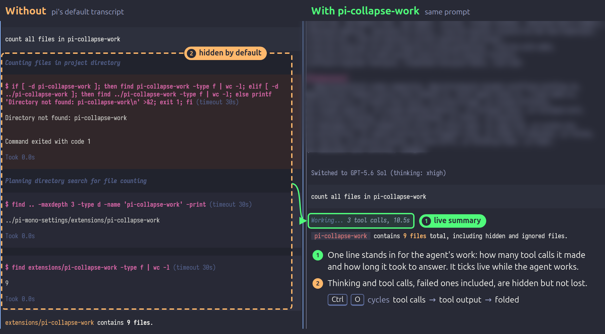

# pi-collapse-work


https://github.com/user-attachments/assets/4e2eeec6-17b9-4373-a49f-72d6a7a51d5c


Most of the models now write scripts which are unreadable to humans. To reduce cognitive load I decided to hide it all. 

What this extension does - it simply folds/hides/collapses everything the agent does between your prompt and its answer - into one line. Showing how many tools were called and how long it took.

So it will look something like:

```
 PROMPT

 Working... 3 tool calls, 3.2s (all tool calls folded/hidden but still availble if needed via ctrl/cmd+o)

 OUTPUT
```

Here it is on a real prompt. On the left is pi's default transcript; on the right is the same prompt with this extension:



While the agent works, the line ticks live: `Working... 1 tool call, 2.5s`. Nothing the agent streams on the way, such as interim text, thinking or tool rows, is shown until it finishes. Then the line freezes and the final answer appears under it.

The time runs from when you sent the prompt to the end of the final answer. The count covers top-level tool calls, so a codemode or batch call counts once.

## Install

Requires pi 0.84.2 or newer.

```bash
pi install git:github.com/xRyul/pi-collapse-work
```

## Ctrl+O

This extension takes over Ctrl+O (or whatever `app.tools.expand` is bound to). Instead of pi's two-way collapse/expand toggle, it cycles three views:

| Press | View |
| --- | --- |
| default | Folded: prompt, `Working...` line, answer |
| 1st | Pi's normal transcript with tool output collapsed |
| 2nd | Pi's normal transcript with tool output expanded |
| 3rd | Folded again |

The status line under the transcript names the view you switched to. In dialogs, selectors and `/tree`, Ctrl+O keeps its usual meaning.

It works alongside [pi-collapse-tools](https://github.com/xRyul/pi-collapse-tools): the "tool calls" view then shows its compact tool rows, and the "tool output" view expands them.

## What stays visible when folded

- Your prompts, including skill blocks.
- The final answer, without its thinking blocks.
- Errors, aborts, warnings, status lines, compaction and branch summaries, custom messages and `!` command output.

An exchange that ended on a tool call (for example, interrupted before the agent answered) shows only its `Working...` line. Press Ctrl+O to see what ran.

## How it works

Pi has no API for hiding transcript entries, so the extension:

1. takes pi's TUI from a widget factory and finds the chat container in pi's document;
2. replaces that container's `render()` with a folded view of its children, leaving the children themselves untouched;
3. listens to raw terminal input for Ctrl+O while the main editor has focus, because extensions cannot register that shortcut, and switches pi's tool expansion with `ctx.ui.setToolsExpanded()`.

Times for past exchanges come from the session file, so they survive `/reload` and resuming a session. If pi changes its interactive layout and the chat container can't be found, the extension shows a warning once and leaves the transcript alone.

MIT
